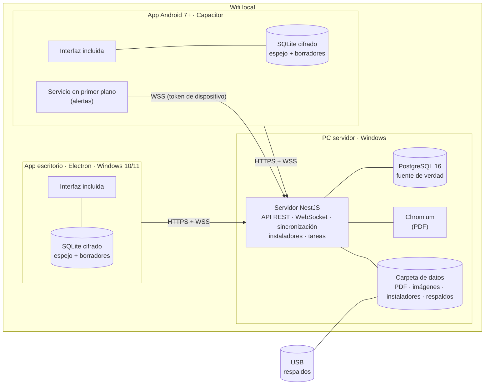
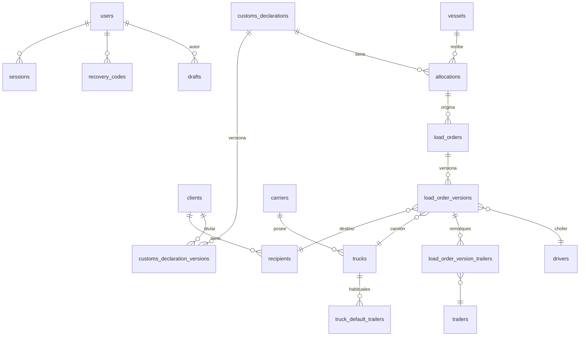

# Plan 001: MVP del Sistema de Órdenes de Carga

| Campo | Valor |
|---|---|
| Versión | 1.1.0 |
| Fecha | 2026-10-12 |
| Spec | `spec.md` 1.0.0 y `ui-spec.md` 1.0.0 |
| Constitución | 1.0.0 |
| Estado | Aprobado · listo para implementación |

Este documento describe **cómo** se construye lo que pide la spec. Cada decisión cita los requisitos (RF, RNF) o los artículos de la constitución que la motivan.

---

## 1. Verificación constitucional

| Artículo | Cómo se cumple | Sección |
|---|---|---|
| I. El sistema calcula | Saldos, cargado, estados de DM y plazos se obtienen por consulta (vistas SQL y funciones de dominio). No hay columnas editables de saldo. | 4.3, 5 |
| II. El saldo es sagrado | Oficializar, corregir, anular y asignar se ejecutan en una transacción con `SELECT … FOR UPDATE` en un orden de bloqueo fijo, más restricciones `CHECK` en la base de datos. Hay pruebas de concurrencia. | 5 |
| III. Lo oficial se versiona | Las tablas `*_versions` son de solo inserción. La versión vigente se marca por puntero y estado. Los PDF se archivan con su hash. | 4.2 |
| IV. Trazabilidad | `audit_log` es de solo inserción: un trigger rechaza `UPDATE` y `DELETE`, y el rol de la aplicación no tiene esos permisos. | 4.2, 9 |
| V. Toneladas exactas | `numeric(12,3)` en la base de datos, `decimal.js` en TypeScript. Una regla de lint prohíbe `parseFloat` y `Number()` en el módulo de dominio. | 4, 8 |
| VI. Numeración | El contador vive en la fila del buque, se bloquea en la misma transacción que la emisión y hay `UNIQUE(vessel_id, seq)`. | 5.2 |
| VII. Servidor como fuente de verdad; espejo local | Toda validación ocurre en el servidor. Cada app replica, en SQLite cifrado, lo que su rol ve, a partir de un registro de cambios ordenado. Los derivados llegan calculados. Los borradores locales viven en la misma base local. | 4.4, 5.9, 7 |
| VIII. Red local sin internet | El instalador completo trae todas las dependencias del servidor. Descubrimiento por mDNS, difusión y búsqueda en la subred; identidad del servidor independiente de la IP; dos montajes soportados; nunca dos servidores (comprobación previa y bloqueo tras traslado) | 10 |
| IX. Un solo código, interfaz incluida | Paquete `web` único, empaquetado dentro de cada app. `desktop` y `android` solo contienen el cascarón. Las actualizaciones se publican en el servidor con versión mínima. | 3, 10 |
| X. Seguridad | argon2id, sesiones en el servidor, CA propia por instalación, verificación de la identidad del servidor en un transporte nativo, emparejamiento con comparación de código, Administrador de instalación con permiso de Windows y código, bloqueo de capturas, permisos por rol | 9, 10 |
| XI. Errores visibles | Códigos de error estables con mensaje en español. Motor de alertas con WebSocket. Las decisiones de excepción exigen motivo. | 6.3, 8 |
| XII. Simplicidad | Un único proceso Node con NestJS, sin colas ni cachés externos. Un solo motor de base de datos. | 3 |
| XIII. Pruebas que verifican | Pruebas primero, oráculo desde la spec, fast-check para propiedades, Stryker con umbral del 90 % en el dominio y las transacciones críticas, escenario real del Excel y controles automáticos de prácticas prohibidas | 11 |
| XV. Apagones | Detector de energía, aviso con batería, modo protegido al 15 %, parada ordenada al 5 %, reanudación automática; PostgreSQL resiste el apagado brusco | 10.6 |
| XIV. Interfaces completas y fluidas | Arquitectura de pantalla con lógica compartida y tres presentaciones (teléfono, tablet, escritorio), sistema de diseño derivado del prototipo, Motion con presets y movimiento reducido, iconos animados, Storybook, maquetas aprobadas, pruebas de contrato, componente, extremo a extremo y regresión visual | 7, 11 |

## 2. Decisiones técnicas clave

| ID | Decisión | Motivo |
|---|---|---|
| DT-01 | Un solo proceso servidor (NestJS) que sirve la API, el WebSocket, la sincronización, la descarga de instaladores y las tareas programadas | Simplicidad (XII) y un solo servicio de Windows que mantener |
| DT-02 | **La interfaz va incluida en cada app.** Electron la sirve con un protocolo propio (`app://impocaribe`) y Capacitor desde sus recursos internos | La app abre sin servidor (RF-CON-01, art. IX) |
| DT-03 | **Copia local en SQLite cifrado** (SQLCipher) con `@capacitor-community/sqlite`, que ofrece la misma API en Android y Electron. Clave aleatoria de 256 bits guardada en Android Keystore o en `safeStorage` de Electron | Una sola implementación para las dos apps (IX) y datos protegidos si se pierde el equipo |
| DT-04 | **Sincronización por registro de cambios** (`change_log`) numerado en orden de *commit*, más un aviso por WebSocket y descarga incremental | Simple, ordenada, sin conflictos: el servidor es el único que escribe (VII) |
| DT-05 | Autenticación con **token Bearer** guardado en almacenamiento seguro, más un **token de dispositivo** separado, solo para alertas, para el servicio nativo de Android. Las cookies se descartan porque la interfaz ya no viene del servidor | DT-02 |
| DT-06 | Durante la emisión, el PDF se genera **dentro de la transacción** | Si falla, se revierte todo y el número no se consume (VI) |
| DT-07 | Respaldo con cifrado híbrido: clave pública en el servidor y clave privada cifrada con la contraseña de respaldo | El respaldo automático cifra sin conocer la contraseña. Restaurar la exige (RF-RES-04). |
| DT-08 | Las tareas de plazo y alertas corren dentro del servidor cada 10 minutos y al arrancar | No depende de que alguien abra la app (RNF-10) |
| DT-09 | Orden global de bloqueo: `vessels` → `customs_declarations` → `allocations` → `load_orders` → `drafts` → `sync_state` | Evita interbloqueos; `sync_state` siempre al final (5.9) |
| DT-10 | PDF en **A4** | Confirmado |
| DT-11 | **API versionada.** Cada petición envía `X-App-Version`, y el servidor responde `426 UPGRADE_REQUIRED` por debajo de la mínima | RF-UPD-04 |
| DT-12 | **Pantalla = lógica + 3 presentaciones.** Cada pantalla tiene un hook de lógica (datos, acciones, validación, estados) y tres componentes de presentación (`.phone.tsx`, `.tablet.tsx`, `.desktop.tsx`) que solo componen piezas del sistema de diseño | Art. IX y XIV: experiencias propias sin duplicar reglas |
| DT-13 | **Motion** (`motion/react`) con `LazyMotion` y el conjunto `domAnimation`, presets centralizados y `MotionConfig` con el movimiento reducido del sistema y del usuario | Fluidez con poco peso y control único (RF-UI-05, 06) |
| DT-14 | **Iconos Lucide** (`lucide-react`) con un componente `AnimatedIcon` propio que aplica los estados de MOV-08 con Motion. No se añaden librerías de animación por fotogramas (Lottie) | Ligero, sin conexión, coherente con el resto del movimiento |
| DT-16 | **Tres instaladores** generados en el mismo proceso de compilación: completo (app + carpeta `server-bundle` con PostgreSQL, Node.js, Chromium y el servidor), ligero (solo la app) y APK. Cada uno con su SHA-256 | RF-INS-01 |
| DT-17 | **Ayudante de instalación elevado** (`impocaribe-setup.exe`): proceso aparte que la app lanza con permiso de administrador de Windows. Ejecuta pasos idempotentes con un diario en disco, deshace cada paso si falla, e informa el progreso a la app por una tubería con nombre | RF-INS-03 a 08 |
| DT-18 | **Identidad del servidor:** UUID y nombre (`IMPOCARIBE-XXXX`), CA propia de la instalación y certificado cuyo nombre alternativo es `<uuid>.impocaribe`. Los clientes verifican la CA (por su huella, aprendida al emparejarse) y la identidad, **sin comparar la IP** | RF-RED-03 |
| DT-19 | **Transporte nativo:** todas las peticiones HTTP y WebSocket de las apps pasan por `platform.http` y `platform.ws`, implementados en nativo (red de Electron y OkHttp en Android), porque el WebView no permite verificar la identidad del servidor de forma propia | DT-18 |
| DT-20 | **Descubrimiento:** servicio DNS-SD `_impocaribe._tcp` (con identidad, puerto, versión y huella de la CA), respuesta a difusión UDP en el puerto 47800, búsqueda en la subred `/24` contra `/api/v1/discovery`, y QR o dirección manual | RF-RED-02 |
| DT-25 | **Validación compartida por campo:** el catálogo de campos (`ui-spec.md` §6) se implementa una sola vez en `shared/validation` como esquemas Zod con mensajes en español, más funciones puras de advertencia. El servidor y la interfaz usan exactamente los mismos | RF-VAL-04, Art. XIV.9 |
| DT-22 | **Idempotencia:** toda escritura lleva el header `Idempotency-Key` (UUID generado por la app por intento de usuario). El servidor guarda la clave con el resultado durante 24 h dentro de la misma transacción; una repetición devuelve el mismo resultado, y la misma clave con otro contenido responde `IDEMPOTENCY_MISMATCH`. Los secretos del cuerpo (contraseñas y códigos) no entran al hash guardado. **Excepción:** las respuestas que llevan un secreto (token de sesión o de dispositivo, códigos de recuperación: login, primer arranque, alta de usuario, juego nuevo de códigos y token de dispositivo) no se guardan; repetirlas es seguro porque solo abren otra sesión, reemplazan el token o los códigos, o chocan con la unicidad | RF-ORD-23 |
| DT-23 | **Concurrencia optimista en ediciones:** cada registro editable tiene `row_version`; toda edición envía `expectedVersion`, y si no coincide responde `STALE_RECORD` con la versión actual | RF-DM-12 |
| DT-24 | **Dispositivo obligatorio:** salvo `/health`, `/discovery` y `/pairing/*`, toda petición exige `X-Device-Id`, `X-Device-Time` y una firma HMAC-SHA256 con el secreto del dispositivo sobre método, ruta, tiempo y hash del cuerpo. El tiempo se compara con la hora del servidor **corregida por el desfase medido** en `/sync/state`, con una ventana de ±5 min, y el servidor rechaza firmas repetidas dentro de esa ventana. `/setup` y `/local/*` solo desde `127.0.0.1` | RF-RED-04, RF-USR-05 |
| DT-21 | **Energía:** proveedor inyectable de estado de energía (en Windows, consulta del estado de energía del sistema cada 30 s), con modo protegido de solo lectura y parada ordenada | RF-ENE |
| DT-15 | **WebView mínimo: Chromium 87.** La interfaz se compila para `chrome87`. La app Android comprueba la versión al iniciar; el paquete de instalación incluye el proveedor de WebView en su última versión compatible con Android 7 | RF-UI-11 |
| DT-26 | **Certificados con `@peculiar/x509`:** la CA de la instalación y el certificado del servidor (DT-18) se generan con esta librería JavaScript pura sobre WebCrypto, sin binarios nativos. Node no trae cómo crear certificados X.509 | Menos código propio en una pieza de seguridad (aprobado por el responsable el 2026-10-15) |
| DT-27 | **Anuncio mDNS con `multicast-dns`:** paquete pequeño, sin binarios nativos, que envía y recibe los paquetes mDNS; el anuncio DNS-SD de DT-20 se arma encima | RF-RED-02 (aprobado por el responsable el 2026-10-15) |

## 3. Arquitectura



**Flujo de datos:**
- **Lecturas:** las pantallas leen siempre de la copia local, así que son instantáneas y funcionan sin conexión.
- **Escrituras:** van al servidor por la API. El servidor valida, guarda, registra el cambio y avisa por WebSocket. Todas las apps, incluida la que escribió, descargan el cambio y actualizan su copia.

### 3.1 Estructura del repositorio

```
impocaribe-ordenes/
├─ docs/Constitution.md
├─ specs/MVP/{spec.md, ui-spec.md, plan.md, tasks.md}
├─ packages/
│  ├─ shared/        # Esquemas Zod, tipos, DTO de sincronización, códigos de error, permisos y dominio puro
│  ├─ server/        # NestJS: módulos por dominio, Drizzle, change_log, plantillas PDF, tareas
│  ├─ web/           # React + Vite: sistema de diseño (ui/), movimiento (motion/), pantallas (screens/),
│  │                 #   motor de sincronización (sync/), repositorio local (local/) y Storybook
│  ├─ desktop/       # Electron: protocolo app://, bandeja, notificaciones, safeStorage, SQLite, instalador NSIS
│  └─ android/       # Capacitor: servicio en primer plano, Keystore, SQLite, FLAG_SECURE, instalación de APK
├─ setup/            # Ayudante de instalación elevado (crear, reparar, actualizar, trasladar, desinstalar)
├─ build/            # Generación de los tres instaladores y del paquete de distribución
└─ pnpm-workspace.yaml
```

### 3.2 Módulos del servidor

| Módulo | Responsabilidad | Requisitos |
|---|---|---|
| `auth` | Login, sesiones, recuperación, tokens de dispositivo | 5.1, 5.2 |
| `users` | Gestión de usuarios y primer arranque | 5.3 |
| `company` | Datos de la empresa, firma oficial, cuño oficial | 5.4 |
| `vessels` | Buques, arribo, viaje | 5.5 |
| `declarations` | DM, versiones, plazo, reactivación | 5.6, 5.8 |
| `allocations` | Asignaciones DM–buque | 5.7 |
| `catalogs` | Clientes, destinatarios, transportistas, camiones, remolques, choferes | 5.9 |
| `drafts` | Borradores, bloqueo de edición, sincronización | RF-ORD-06 a 11 |
| `orders` | Validación, emisión, corrección, anulación, numeración | 5.10 |
| `documents` | Renderizado y archivo de PDF, copias | 5.11, RF-ORD-21 |
| `dashboard` | Tablero, búsqueda, seguimiento | 5.12 |
| `alerts` | Motor de alertas, WebSocket, audiencias | 5.13 |
| `audit` | Bitácora (interceptor y consulta) | 5.14 |
| `backups` | Respaldo, cifrado, restauración | 5.15 |
| `scheduler` | Tareas periódicas | DT-08 |
| `sync` | Registro de cambios, instantánea inicial, cambios incrementales, época y alcance por rol | 5.16, 4.4, 5.9 |
| `updates` | Publicación del instalador ligero y del APK, versión mínima y control `X-App-Version` | 5.17 |
| `discovery` | Anuncio DNS-SD, respuesta a difusión, `/discovery` con la identidad | 5.21 |
| `pairing` | Solicitudes de emparejamiento, código de comparación, token de QR, dispositivos y revocación | 5.21 |
| `power` | Estado de energía, AL-20, modo protegido y parada ordenada | 5.22 |
| `local-admin` | Endpoints solo accesibles desde la propia PC servidor (`127.0.0.1`): estado, confirmar emparejamientos, QR | RF-INS-04 |

Las funciones de dominio puras (cálculo de saldos, estado de DM, plazo, formato de número, validaciones) viven en `shared/domain`. Las usan el servidor, para decidir, y la interfaz, como ayuda visual.

---

## 4. Modelo de datos

**Convenciones:**

| Aspecto | Regla |
|---|---|
| Identificadores | `uuid` (v7, ordenable) |
| Fechas con hora | `timestamptz` |
| Fechas de negocio | `date`, interpretadas en `America/Havana` |
| Toneladas | `numeric(12,3)` con `CHECK (x >= 0)` o `> 0` según el caso |
| Nombres | Inglés en el esquema (glosario de la spec, sección 3) |

### 4.1 Diagrama



### 4.2 Tablas

#### Usuarios y seguridad

**`users`**

| Columna | Tipo | Restricciones |
|---|---|---|
| id | uuid | PK |
| username | text | UNIQUE, minúsculas |
| full_name | text | NOT NULL |
| national_id | char(11) | NOT NULL, CHECK solo dígitos |
| phone | text | NOT NULL |
| role | enum `apoderada`, `operador`, `lectura` | NOT NULL |
| password_hash | text | argon2id |
| must_change_password | bool | default false |
| failed_logins | int | default 0 |
| locked_until | timestamptz | NULL |
| active | bool | default true |
| created_at, updated_at | timestamptz | |

**`sessions`**

| Columna | Tipo | Notas |
|---|---|---|
| id | uuid | PK |
| user_id | uuid | FK `users` |
| token_hash | text | UNIQUE (SHA-256 del token) |
| kind | enum `app`, `device` | `app` = token Bearer de la app. `device` = token de alertas del servicio Android (DT-05) |
| device_id, device_label, platform | text | `windows` o `android` |
| keep_signed_in | bool | 24 h o 30 días (RF-AUT-02) |
| expires_at, last_seen_at, revoked_at | timestamptz | |

**`recovery_codes`**

| Columna | Tipo | Notas |
|---|---|---|
| id | uuid | PK |
| user_id | uuid | FK |
| batch_id | uuid | Al generar un juego nuevo, se invalida el anterior |
| code_hash | text | argon2id |
| used_at, invalidated_at | timestamptz | |

**`recovery_attempts`**: user_id, at, success, device_id. Sirve para el límite de 3 intentos por hora (RF-REC-04).

#### Empresa

**`system_settings`** (una sola fila, con `id = 1` y CHECK)

| Columna | Notas |
|---|---|
| legal_name, address | Cabecera (RF-EMP-06) |
| pdf_page_size | `A4` fijo en el MVP (DT-10) |
| max_loading_days_ahead | int, default 7, CHECK 0 a 30 (RF-CFG-02) |
| workday_start, workday_end | time, default 07:00 y 19:00. Respaldos cada hora |
| daily_backup_hour | time, default 20:00 |
| external_backup_dir | text. Carpeta de la USB |
| network_setup | enum `router`, `hotspot` (RF-CFG-02) |
| installation_code_hash | argon2id del código de instalación (RF-INS-02, RF-CFG-04) |
| deadline_legal_notice | text. Texto del aviso legal del plazo (RF-DM-13), entre 50 y 600 caracteres |
| backup_password_confirmed_at | timestamptz. Última confirmación de la contraseña de respaldo (RF-RES-08) |
| backup_password_postponements | int. Aplazamientos usados en el ciclo actual (máximo 3) |
| server_state | enum `active`, `migrated`. Un servidor `migrated` no arranca (D14) |
| backup_public_key | DT-07 |
| backup_private_key_enc | Clave privada cifrada con la contraseña de respaldo (scrypt + AES-256-GCM) |
| current_signature_id, current_stamp_id | FK |

**`official_signatures`**: id, file_id, representative_name, credential_no, position, created_by, created_at. Solo inserción.

**`official_stamps`**: id, file_id, created_by, created_at. Solo inserción.

**`files`**: id, sha256, mime, size_bytes, storage_path, created_at. El binario se guarda en disco, en la carpeta de datos.

**Identidad del servidor:** no vive solo en la base de datos. Se guarda en `C:\ProgramData\Impocaribe\identity\`, protegida con la protección de datos de Windows para la máquina: UUID, nombre, clave privada de la CA y certificado. Se incluye en los respaldos de traslado.

#### Idempotencia

**`idempotency_keys`**: key (uuid), user_id, device_id, method, path, request_hash, status_code, response jsonb, created_at, expires_at (24 h). PK (device_id, key). Se depura cada hora.

**Concurrencia optimista:** todas las tablas editables (`vessels`, `customs_declarations`, `allocations`, catálogos, `users`, `system_settings`) tienen `row_version int` que se incrementa en cada cambio.

#### Dispositivos y emparejamiento

**`devices`**: id, name, platform, app_version, paired_at, paired_method (`code`, `qr`), last_seen_at, revoked_at, revoked_by.

**`pairing_requests`**: id, device_name, platform, client_nonce, server_nonce, code (6 dígitos derivados de un hash de la huella de la CA y ambos nonces), status (`pending`, `confirmed`, `rejected`, `expired`), created_at, expires_at (5 min), resolved_at.

Las sesiones (`sessions`) pasan a referenciar `device_id`.

#### Buques

**`vessels`**

| Columna | Tipo | Restricciones y notas |
|---|---|---|
| id | uuid | PK |
| name | text | NOT NULL |
| code | text | Derivado de `name` al guardar (RF-BUQ-02) |
| manifest, bl, port, internal_buyer | text | |
| eta_date | date | Fecha estimada, opcional |
| arrival_date | date | Fecha real, NULL hasta el arribo. Un trigger impide cambiarla si existen órdenes (RF-BUQ-07) |
| voyage_no | int | NULL hasta el arribo (RF-BUQ-03) |
| total_tons | numeric(12,3) | CHECK > 0 |
| last_order_seq | int | default 0. Contador de numeración (5.2) |
| status | enum `open`, `closed` | RF-BUQ-08 |
| closed_at, closed_by | | |

Restricción adicional: `UNIQUE(code, extract(year from arrival_date), voyage_no)` cuando `arrival_date` no es NULL.

#### DM y asignaciones

**`customs_declarations`**

| Columna | Tipo | Notas |
|---|---|---|
| id | uuid | PK |
| number | char(5) | UNIQUE para siempre, CHECK `^[0-9]{5}$` (RF-DM-01, 02) |
| client_id | uuid | FK. Inmutable (D13), protegido por trigger |
| declaration_date | date | Fecha de creación en hora de La Habana. Inmutable (D13) |
| current_version_id | uuid | FK |
| deadline_start_date | date | Día 1 del plazo: `declaration_date` o fecha de la última reactivación |
| expired_at | timestamptz | NULL salvo que esté vencida |
| created_at | timestamptz | |

**`customs_declaration_versions`** (solo inserción)

| Columna | Tipo | Notas |
|---|---|---|
| id | uuid | PK |
| declaration_id | uuid | FK |
| version_no | int | UNIQUE(declaration_id, version_no) |
| brand | text | Modificable por versión |
| total_tons | numeric(12,3) | NULL = pendiente de total. Modificable por versión |
| kind | enum `create`, `edit`, `reactivate`, `expire` | |
| reason | text | NOT NULL salvo en `create` |
| created_by, created_at | | |

**`allocations`**

| Columna | Tipo | Notas |
|---|---|---|
| id | uuid | PK |
| declaration_id | uuid | FK |
| vessel_id | uuid | FK. UNIQUE(declaration_id, vessel_id) |
| allocated_tons | numeric(12,3) | CHECK ≥ 0 |
| created_at, updated_at | | |

**`allocation_changes`** (solo inserción): allocation_id, previous_tons, new_tons, kind (`assign`, `partial_assign`, `edit`, `expire_release`, `void_release`), reason, created_by, created_at.

#### Catálogos

| Tabla | Columnas |
|---|---|
| `clients` | id, name, name_normalized UNIQUE (mayúsculas, sin acentos, sin puntuación ni espacios repetidos; función `normalizeName` de `shared/domain`), active |
| `recipients` | id, client_id, name, address, active |
| `carriers` | id, name UNIQUE, active |
| `trucks` | id, plate UNIQUE, tractor_plate NULL, carrier_id, base_location default `'LA HABANA'`, active |
| `trailers` | id, plate UNIQUE, capacity_tons numeric(12,3) CHECK > 0, carrier_id NOT NULL (FK `carriers`), active |
| `truck_default_trailers` | truck_id, trailer_id, position. PK compuesta |
| `drivers` | id, full_name, national_id char(11) UNIQUE (identificador del chofer), license_no char(11) UNIQUE, carrier_id NOT NULL (FK `carriers`), active. Todos NOT NULL. El cambio de `carrier_id` exige motivo y queda en la bitácora |
| `trucks` (restricción) | Un camión activo debe tener al menos un remolque habitual: se valida en el servicio y con un trigger diferido |

Las chapas y carnés se normalizan antes de guardar y comparar: mayúsculas, sin espacios.

#### Órdenes

**`load_orders`**

| Columna | Tipo | Notas |
|---|---|---|
| id | uuid | PK |
| vessel_id | uuid | FK |
| seq | int | UNIQUE(vessel_id, seq) |
| number | text | UNIQUE. `EAGLE1-2026-V1-0001` |
| declaration_id | uuid | FK |
| allocation_id | uuid | FK |
| current_version_id | uuid | FK |
| status | enum `official`, `voided` | Estado de la versión vigente |
| created_at | timestamptz | |

**`load_order_versions`** (solo inserción)

| Columna | Tipo | Notas |
|---|---|---|
| id | uuid | PK |
| order_id | uuid | FK. UNIQUE(order_id, version_no) |
| version_no | int | |
| status | enum `official`, `replaced`, `voided` | Único campo que cambia: `official` → `replaced`, por trigger controlado |
| declaration_version_id | uuid | Versión de DM vigente al emitir (RF-DM-04) |
| recipient_id, truck_id, driver_id | uuid | FK |
| tons | numeric(12,3) | CHECK > 0 |
| waybill_no | text | Carta de porte |
| lot_no, route_sheet_no, container | text | NULL |
| loading_date | date | |
| issued_at | timestamptz | Fecha de emisión |
| issued_by | uuid | |
| issued_device | text | |
| reason | text | Obligatorio para `version_no` > 1 |
| capacity_override_reason | text | NULL. RF-ORD-13 |
| same_day_override_reason | text | NULL. RF-ORD-13 |
| signature_id, stamp_id | uuid | Firma y cuño aplicados |
| snapshot | jsonb | Todos los datos impresos, congelados |
| pdf_file_id | uuid | FK `files` |
| pdf_sha256 | text | |

La versión anulada (`voided`) no descuenta saldo y su PDF lleva la marca ANULADA.

**`load_order_version_trailers`**: version_id, trailer_id, position, capacity_tons_snapshot.

**Índice de apoyo para D5:** índice parcial sobre `(truck_id, loading_date)` en `load_order_versions WHERE status = 'official'`. Sirve solo para detectar; la repetición se permite con decisión.

#### Borradores

**`drafts`**

| Columna | Tipo | Notas |
|---|---|---|
| id | uuid | PK |
| client_draft_id | uuid | UNIQUE. Lo genera el dispositivo, para que la subida sea idempotente |
| owner_id | uuid | |
| visibility | enum `private`, `shared` | |
| payload | jsonb | Validado con el esquema Zod de borrador |
| locked_by | uuid | NULL |
| lock_expires_at | timestamptz | Renovado con un latido cada 60 s; expira a los 10 min sin actividad |
| shared_at, updated_at, discarded_at | timestamptz | |
| issued_order_id | uuid | NULL. Se llena al oficializar |

#### Alertas, bitácora y respaldos

**`alerts`**

| Columna | Notas |
|---|---|
| id | |
| type | `AL-01` … `AL-16`, sin las solo locales |
| kind | `condition` o `event` |
| dedupe_key | Por ejemplo `AL-01:{declaration_id}`. UNIQUE parcial donde `status='open'` |
| audience_roles | text[] |
| target_user_id | NULL. Para AL-08, el autor |
| entity_type, entity_id, payload | jsonb |
| status | `open`, `resolved`, `attended` |
| created_at, resolved_at, attended_by, attended_at | |

**`audit_log`** (solo inserción, protegida por trigger)

| Columna | Notas |
|---|---|
| id | bigserial |
| at | timestamptz |
| user_id, session_id, device_id | |
| action | Por ejemplo `order.issue`, `order.void`, `override.capacity`, `pdf.reprint` |
| entity_type, entity_id | |
| before, after | jsonb |
| reason | |
| ok | bool. Las validaciones bloqueadas se registran con `ok = false` |

**`backups`**: id, kind (`auto`, `manual`, `pre_restore`), started_at, finished_at, status, file_path, size_bytes, sha256, error.

#### Cierre de buque y restauración

**`vessel_surplus_dispositions`**: id, vessel_id, tons, kind (`allocate`, `transfer`, `loss`), target_vessel_id NULL, target_allocation_id NULL, reason, created_by, created_at. Solo inserción.

**`restore_runs`**: id, backup_id, pre_restore_backup_id, started_at, finished_at, restored_by, numbering_source (`pre_restore` o `manual`).

**`lost_orders`**: id, restore_run_id, vessel_id, seq, number, payload jsonb (datos completos de todas sus versiones), pdf_file_id, status (`pending`, `recovered`, `discarded`), resolved_by, resolved_at, reason, last_error.

### 4.3 Vistas derivadas

Ninguna guarda datos: solo calculan.

```sql
-- Cargado por asignación (solo versiones vigentes oficiales)
CREATE VIEW v_allocation_balance AS
SELECT a.id AS allocation_id, a.declaration_id, a.vessel_id, a.allocated_tons,
       COALESCE(SUM(v.tons) FILTER (WHERE v.status = 'official'), 0)::numeric(12,3) AS loaded_tons,
       a.allocated_tons - COALESCE(SUM(v.tons) FILTER (WHERE v.status = 'official'), 0) AS balance_tons
FROM allocations a
LEFT JOIN load_orders o ON o.allocation_id = a.id
LEFT JOIN load_order_versions v ON v.id = o.current_version_id
GROUP BY a.id;

-- v_declaration_balance: total (versión vigente), asignado, cargado, saldo, pendiente_asignar,
--   días de plazo y estado derivado (RF-DM-06)
-- v_vessel_balance: total, asignado, libre, cargado, restante (RF-BUQ-06)
```

El estado de la DM se calcula con la misma regla en SQL, para filtrar, y en `shared/domain/declarationStatus.ts`, para la interfaz. Una prueba verifica que ambos coinciden.

---

### 4.4 Sincronización y versiones de apps

**`sync_state`** (una sola fila)

| Columna | Notas |
|---|---|
| last_seq | bigint. Último número de cambio confirmado |
| epoch | uuid. Cambia al restaurar un respaldo; obliga a todas las apps a reconstruir su copia |
| schema_version | int. Versión del formato de los DTO de sincronización |

**`change_log`** (solo inserción; se depura tras 30 días)

| Columna | Notas |
|---|---|
| seq | bigint PK. Asignado desde `sync_state.last_seq + 1` al final de la transacción (5.9) |
| entity_type | `vessel`, `declaration`, `allocation`, `order`, `client`, `recipient`, `carrier`, `truck`, `trailer`, `driver`, `draft`, `alert`, `user_directory`, `user_admin` |
| entity_id | uuid |
| op | `upsert` o `delete` (las bajas lógicas viajan como `upsert`) |
| audience | `all`, `editors` (A y O), `apoderada` o `user:{id}` |
| payload | jsonb. El DTO completo ya calculado, por ejemplo una DM con versión vigente, saldos, estado y plazo |
| ref_date | date. Fecha de referencia para la ventana de 12 meses |
| committed_at | timestamptz |

**`app_releases`**

| Columna | Notas |
|---|---|
| id | |
| platform | `windows`, `android`, `android-webview-chrome` o `android-webview-system` (los dos últimos, para P-27) |
| version | semver. UNIQUE(platform, version) |
| file_id, sha256 | Instalador |
| notes | Novedades |
| is_min_supported | bool. Marca la versión mínima compatible vigente |
| published_by, published_at | |

**Qué se replica:**

| Entidad | Contenido del DTO | Audiencia |
|---|---|---|
| Buque | Datos, más total, asignado, libre, cargado y restante | todos |
| DM | Versión vigente, cliente, marca, total, asignado, cargado, saldo, pendiente de asignar, estado, inicio del plazo, días | todos |
| Asignación | Asignado, cargado, saldo | todos |
| Orden | Número, estado, versión vigente resumida, lista de versiones (sin PDF) | todos |
| Catálogos | Registros completos, incluidos los inactivos | todos |
| Borrador compartido | Contenido y bloqueo | editors |
| Borrador privado subido | Contenido | `user:{autor}` |
| Alerta | Tipo, estado, referencia | según la tabla AL de la spec |
| Directorio de usuarios | id, nombre, rol, activo | todos |
| Usuario (administración) | Carné, teléfono, etc. | apoderada |

**No se replican:** la firma, el cuño, los PDF, la bitácora, los respaldos ni las sesiones. Todo eso se consulta en línea.

## 5. Transacciones críticas

Todas usan aislamiento `READ COMMITTED`, con bloqueos explícitos en el orden de DT-09. Toda transacción que falla se revierte por completo y registra el intento en la bitácora (`ok = false`), en una transacción aparte.

### 5.1 Emitir una orden (RF-ORD-12, RF-ORD-13)

```
BEGIN
 1. SELECT vessel FOR UPDATE                     -- serializa la numeración del buque
 2. SELECT declaration FOR UPDATE
 3. SELECT allocation FOR UPDATE
 4. Leer firma y cuño vigentes; si falta alguno → MISSING_OFFICIAL_SIGNATURE
 5. Validar con shared/domain/validateIssue():
      campos, estado de la DM, arribo real, fecha de carga, activos,
      saldo de la asignación (recalculado DENTRO de la transacción),
      capacidad (suma de remolques) y camión el mismo día → si no hay
      motivo de excepción, error *_REQUIRES_OVERRIDE
 6. seq = vessel.last_order_seq + 1 ; UPDATE vessels SET last_order_seq = seq
 7. INSERT load_orders, load_order_versions (v1, official), trailers
 8. Construir snapshot → renderizar el PDF (Chromium, límite 10 s) → guardar el archivo
 9. UPDATE drafts SET issued_order_id …  (si venía de un borrador)
10. INSERT audit_log ; INSERT alerts (AL-06, AL-07 si hubo excepción)
11. recordChanges(): orden, asignación, DM, buque, borrador y alertas (5.9)
COMMIT
→ después del COMMIT: WebSocket sync.available y alert.created; la respuesta lleva syncSeq y el PDF original
```

Si el PDF falla, todo se revierte y el número no se consume (DT-06). El archivo escrito en el paso 8 se borra si no hay COMMIT.

### 5.2 Numeración

- El número se forma como `code + '-' + year(arrival_date) + '-V' + voyage_no + '-' + lpad(seq, 4, '0')`.
- El bloqueo de fila del buque garantiza que no haya huecos ni duplicados, y `UNIQUE(vessel_id, seq)` es la segunda barrera.
- Si se superan 9999 órdenes en un viaje, el ID crece a 5 dígitos sin romper el orden.

### 5.3 Corregir (RF-ORD-17)

1. Se bloquean, en orden, el buque, la DM, la asignación y la orden.
2. El saldo disponible se calcula como saldo + toneladas de la versión vigente.
3. Se valida igual que en la emisión, con tres diferencias:
   - la fecha de carga se compara con la fecha de emisión de la **versión 1**;
   - la orden que se corrige no cuenta para la regla de camión repetido;
   - una DM vencida o un buque cerrado no bloquean, pero si la DM está vencida las toneladas nuevas deben ser ≤ las de la versión vigente (`EXPIRED_CANNOT_INCREASE`).
4. La versión n pasa a `replaced` y se inserta la versión n+1 `official`, con su motivo.
5. Se genera el PDF y se actualiza `current_version_id`.

No se pueden cambiar la DM ni la asignación (RF-ORD-18): la API ni siquiera acepta esos campos.

Si la corrección reduce toneladas y la DM está vencida, la asignación se reduce al nuevo cargado (`void_release`). Si además el buque está cerrado, la diferencia queda como sobrante sin destino y se abre AL-17.

### 5.4 Anular (RF-ORD-19)

1. Se aplican los mismos bloqueos.
2. Se inserta la versión n+1 `voided`, con el snapshot de la versión n, el motivo y un PDF con la marca ANULADA. El PDF reutiliza la firma y el cuño de la versión n (RF-EMP-03), así que anular no exige que estén cargados.
3. La orden queda con `status = voided`.
4. Si la DM está vencida, la asignación se reduce al nuevo cargado y se registra `allocation_changes.kind = void_release` (caso límite 4).
5. Si el buque está cerrado, las toneladas devueltas quedan como sobrante sin destino y se abre AL-17.

### 5.5 Asignar una DM a un buque (RF-ASG-01, RF-ASG-02)

1. Se bloquean el buque y la DM.
2. Si la DM no tiene total, responde `DECLARATION_PENDING_TOTAL`. Si el buque está cerrado, `VESSEL_CLOSED`. Si la DM está vencida o cerrada, el error de su estado.
3. Se calcula `libre(buque)` y `pendiente_asignar(DM)`.
4. Si lo pedido es mayor que `libre(buque)` y no viene `confirmPartial: true` con motivo, se responde `409 ALLOCATION_EXCEEDS_VESSEL` con `{exceso, libre}`. La interfaz pregunta: con "No", deja el buque vacío; con "Sí", reenvía con el motivo.
5. Con confirmación, se asigna `min(pedido, libre)`, se registra un `partial_assign` y se emite la alerta AL-10.

### 5.6 Editar una DM (RF-DM-04, RF-DM-05)

1. Se bloquea la DM.
2. Si `total_nuevo < cargado`, se responde `TOTAL_BELOW_LOADED` con el cargado actual.
3. También se exige que `total_nuevo ≥ asignado`. En caso contrario, primero hay que reducir asignaciones.
4. Solo se aceptan `total_tons` y `brand`. Cualquier otro campo responde `FIELD_IMMUTABLE`.
5. Se inserta una versión nueva con su motivo y se actualiza `current_version_id`.

### 5.7 Vencimiento y reactivación (RF-PLZ-01 a 05)

**Regla de días** (`shared/domain/deadline.ts`): `día = (hoy_Habana − deadline_start_date) + 1`. El día 25 abre AL-03. La DM vence cuando `día ≥ 31`, es decir, cuando `hoy_Habana ≥ deadline_start_date + 30`.

**La validación de emisión calcula el día en el momento** con la hora del servidor (RF-ORD-24). `expired_at` lo marca la tarea programada para liberar asignaciones y emitir AL-04, pero ninguna regla de emisión depende de que ya esté marcado.

**Tarea de vencimiento** (cada 10 minutos y al arrancar). Para cada DM no cerrada, sin `expired_at` y con `día ≥ 31`:

1. Se bloquea la DM y luego cada buque de sus asignaciones, ordenados por id.
2. Cada asignación se reduce a su cargado y se registra un `expire_release`.
3. Se marca `expired_at`, se inserta una versión `expire` y se emite la alerta AL-04.

Al empezar el día 25 se abre la alerta AL-03, que se resuelve sola si la DM se cierra o vence.

**Reactivación:** se inserta una versión `reactivate` con su motivo, `deadline_start_date` pasa a ser hoy y `expired_at` vuelve a NULL. El restante queda pendiente de asignación.

### 5.8 Bloqueo de borradores (RF-ORD-09)

- `POST /drafts/:id/lock` aplica un `UPDATE … WHERE locked_by IS NULL OR lock_expires_at < now()`.
- Si no logra el bloqueo, responde `DRAFT_LOCKED` con el nombre de quien lo tiene.
- Un latido cada 60 segundos extiende el bloqueo 10 minutos.
- Una Apoderada puede forzar la liberación, y queda en la bitácora.

---

### 5.9 Registro de cambios (DT-04)

**En el servidor:** toda transacción que modifica datos replicables llama, como **último paso antes del COMMIT**, a `recordChanges(tx, cambios[])`:

1. `UPDATE sync_state SET last_seq = last_seq + n RETURNING last_seq`. El bloqueo de esta fila ordena los commits, así que los números siempre quedan confirmados en orden y ningún cliente se salta un cambio.
2. Se recalculan los DTO afectados. Por ejemplo, emitir una orden produce cambios de la orden, la asignación, la DM y el buque.
3. Se insertan en `change_log`.
4. Tras el COMMIT se emite por WebSocket `sync.available {seq}`.

Con 15 usuarios, serializar este último paso cuesta milisegundos.

**Cambios por tiempo:** las tareas programadas (vencimiento, día 25, alertas por tiempo) registran sus cambios igual que cualquier otra escritura. El contador de días se recalcula en el dispositivo a partir de `deadline_start_date` solo para mostrarlo; el estado Vencida siempre llega del servidor.

**En la app:**

| Momento | Acción |
|---|---|
| Primer inicio de sesión, época distinta o `schema_version` distinta | `GET /sync/snapshot` paginado: guarda todo dentro de una transacción local y registra `seq` y `epoch` |
| Aviso `sync.available`, reconexión o cada 60 s | `GET /sync/changes?since={seq}`: aplica en orden dentro de una transacción local |
| `since` más viejo que lo depurado (más de 30 días) | El servidor responde `410 RESYNC_REQUIRED`, la app borra la copia y descarga una instantánea |
| Cada día | Borra de la copia lo inactivo con `ref_date` mayor a 12 meses |

Después de una escritura propia, la app no edita su copia a mano: espera el cambio del servidor. La respuesta de la API ya incluye el `seq` resultante, y la app sincroniza hasta ese número antes de mostrar el resultado. Así lo que se ve es siempre lo que el servidor confirmó.

### 5.10 Numeración tras una restauración (D12, RF-RES-03, 06, 07)

1. Antes de restaurar se hace el respaldo `pre_restore` del estado actual.
2. Tras restaurar, ese respaldo se carga en una base temporal (`restore_staging`).
3. Para cada buque se calcula `max_seq` en la base temporal y `last_order_seq = max(restaurado, max_seq)`. Así el contador nunca retrocede.
4. Las órdenes con `seq` mayor que el máximo restaurado se copian a `lost_orders` con todas sus versiones y su PDF.
5. Si el `pre_restore` no se pudo hacer (base dañada), el sistema entra en **modo de confirmación**: la Apoderada escribe el último número impreso de cada buque abierto, y el contador toma el mayor entre ese valor y el restaurado. Hasta confirmarlo, no se pueden emitir órdenes.
6. **Recuperar una orden perdida** es una transacción como la emisión (5.1), pero conserva el `seq`, el número, las fechas y el PDF original. Valida el saldo y, si falla, deja la orden en `pending` con `last_error`.

### 5.11 Cierre de buque (RF-BUQ-08, 09)

1. Se bloquea el buque y se calcula el sobrante: `libre + Σ(asignado − cargado)` de sus asignaciones.
2. Si el sobrante es mayor que 0,000 t sin destino registrado, responde `SURPLUS_UNRESOLVED` con el detalle.
3. Los destinos se registran en `vessel_surplus_dispositions`:
   - `allocate`: se hace por el flujo normal de asignación (5.5) y el registro apunta a la asignación;
   - `transfer`: en la misma transacción se bloquea el buque destino (por id, para respetar DT-09), se suma `tons` a su `total_tons` y se registra en ambos buques;
   - `loss` (merma): solo Apoderada, con motivo.
4. Con el sobrante resuelto, el buque pasa a `closed` y se registra en la bitácora y en la sincronización.

## 6. Contrato de API

**Convenciones:**

| Aspecto | Regla |
|---|---|
| Base | `https://{servidor}:8443/api/v1` |
| Formato | JSON |
| Validación | Esquemas Zod de `shared` |
| Toneladas | Viajan como **cadena** decimal (`"17.280"`) para no perder exactitud |
| Fechas de negocio | `YYYY-MM-DD` |
| Autenticación | `Authorization: Bearer {token}` en todas las peticiones (DT-05) |
| Versión de app | Header `X-App-Version` obligatorio. Por debajo de la mínima responde `426 UPGRADE_REQUIRED` (DT-11) |
| Origen | CORS permitido solo para `app://impocaribe`, `https://localhost` y `capacitor://localhost` |
| Respuesta de escritura | Incluye `syncSeq`: el número de cambio hasta el que la app debe sincronizar |
| Idempotencia | Header `Idempotency-Key` obligatorio en `POST`, `PATCH` y `DELETE` (DT-22) |
| Concurrencia | `expectedVersion` obligatorio en ediciones (DT-23) |
| Dispositivo | `X-Device-Id` y firma del dispositivo (DT-24) |
| Permisos | Matriz de la spec (sección 2), aplicada con el decorador `@Allow(role…)` |

### 6.1 Formato de error

```json
{ "code": "OVERDRAFT_ALLOCATION",
  "message": "Sobregiro: la orden supera el saldo por 7,280 t. Quedan 10,000 t en el DM 00431 (buque EAGLE1).",
  "details": { "requested": "17.280", "balance": "10.000", "excess": "7.280" } }
```

### 6.2 Endpoints

| Método y ruta | Rol | Descripción | Requisitos |
|---|---|---|---|
| **Primer arranque** | | | |
| `GET /setup/status` | dispositivo emparejado | ¿Existe alguna Apoderada? | RF-USR-05 |
| `POST /setup` | solo `127.0.0.1`, una sola vez | Crea la primera Apoderada y devuelve sus códigos de recuperación | RF-USR-05 |
| **Autenticación** | | | |
| `POST /auth/login` | público | `{username, password, keepSignedIn, deviceId, platform}` → `{token, expiresAt, user}` | RF-AUT-01, 02, 05 |
| `POST /auth/logout` | sesión | Cierra la sesión actual | |
| `GET /auth/me` | sesión | Usuario, rol y permisos | |
| `POST /auth/change-password` | sesión | Cierra las demás sesiones | RF-AUT-04 |
| `GET /auth/sessions` · `DELETE /auth/sessions/:id` · `DELETE /auth/sessions` | sesión | Gestión de las propias sesiones | RF-AUT-07 |
| `POST /auth/recovery-codes` | sesión | Genera un juego nuevo e invalida el anterior | RF-REC-03 |
| `POST /auth/recover` | público | `{username, nationalId, phone, code, newPassword}` | RF-REC-02, 04, 05 |
| `POST /auth/device-token` | sesión | Emite un token de alertas para el servicio de Android | DT-05 |
| **Usuarios** | | | |
| `GET/POST /users` · `PATCH /users/:id` | A | Gestión de usuarios | RF-USR-01 a 04 |
| `POST /users/:id/activate` · `/deactivate` | A | Desactivar cierra sus sesiones | RF-AUT-04 |
| `POST /users/:id/reset-password` | A | Contraseña temporal | RF-REC-06 |
| **Empresa** | | | |
| `GET /company` · `PATCH /company` | todos · A | Datos de la empresa | RF-EMP-06 |
| `GET /settings` · `PATCH /settings` | A | Configuración del sistema | RF-CFG-01, 02 |
| `POST /settings/installation-code` | A | `{currentCode, newCode}`: cambia el código de instalación | RF-CFG-04 |
| `GET /company/signature` · `PUT` (multipart) | A | Firma oficial con sus datos | RF-EMP-01, 02, 05 |
| `GET /company/stamp` · `PUT` (multipart) | A | Cuño oficial | RF-EMP-01, 05 |
| `GET /company/official-status` | A, O | ¿Están cargadas la firma y el cuño? | RF-EMP-04 |
| **Buques** | | | |
| `GET /vessels` · `POST /vessels` | todos · A, O | Lista con saldos y alta | 5.5 |
| `GET /vessels/:id` · `PATCH /vessels/:id` | todos · A, O | Detalle y cambios (el total exige motivo) | RF-BUQ-05 |
| `POST /vessels/:id/arrival` | A, O | `{arrivalDate}`. Asigna el viaje. Si hay órdenes, responde `ARRIVAL_DATE_LOCKED` | RF-BUQ-03, 07 |
| `GET /vessels/:id/surplus` | todos | Sobrante y destinos registrados | RF-BUQ-08 |
| `POST /vessels/:id/surplus-dispositions` | A, O (`loss` solo A) | `{kind, tons, targetVesselId?, targetAllocationId?, reason}` | RF-BUQ-08, 09 |
| `POST /vessels/:id/close` | A, O | Cerrar el buque | RF-BUQ-08 |
| **DM** | | | |
| `GET /declarations` | todos | Filtros: estado, buque, cliente, texto | RF-TAB-02 |
| `POST /declarations` | A, O | Alta, con asignación inicial opcional | RF-DM-01, 03 |
| `GET /declarations/:id` | todos | Ficha con saldos, asignaciones, plazo y órdenes | RF-TAB-03 |
| `POST /declarations/:id/versions` | A, O | Edición con motivo | RF-DM-04, 05 |
| `POST /declarations/:id/reactivate` | A, O | Con motivo | RF-PLZ-04 |
| `GET /declarations/:id/history` | todos | Versiones y bitácora | RF-BIT-04 |
| `GET /declarations/:id/tracking.pdf` | todos | Seguimiento en PDF | RF-TAB-06 |
| **Asignaciones** | | | |
| `POST /declarations/:id/allocations` | A, O | `{vesselId, tons, confirmPartial?, reason?}` | 5.7 |
| `PATCH /allocations/:id` | A, O | `{tons, reason}` | RF-ASG-03 |
| **Catálogos** | | | |
| `GET/POST /clients` · `PATCH /clients/:id` | todos · A, O | | RF-CAT-01 |
| `POST /clients/:id/recipients` · `PATCH /recipients/:id` | A, O | | RF-CAT-01 |
| `GET/POST/PATCH /carriers`, `/trucks`, `/trailers`, `/drivers` | todos · A, O | `…/:id/activate` y `/deactivate`. `GET /drivers?carrierId=` filtra por transportista | RF-CAT-02 a 07 |
| `POST /drivers/:id/carrier` | A, O | `{carrierId, reason}` | RF-CAT-09 |
| `GET /validation/unique?field=&value=` | A, O | Comprobación de duplicados en el servidor, para confirmar la hecha contra la copia local | RF-VAL-06 |
| `GET /catalogs/duplicates?type=&value=` | A, O | Aviso de posibles duplicados | RF-CAT-08 |
| **Borradores** | | | |
| `GET /drafts?scope=mine\|shared` | A, O | | RF-ORD-06 a 08 |
| `POST /drafts` | A, O | `{clientDraftId, visibility, payload}`, idempotente | RF-ORD-07 |
| `POST /drafts/sync` | A, O | Sube en lote los borradores locales como privados | RF-ORD-08 |
| `PATCH /drafts/:id` | A, O | Requiere tener el bloqueo si es compartido | RF-ORD-09 |
| `POST /drafts/:id/share` | autor | Privado → compartido | RF-ORD-07 |
| `POST/DELETE /drafts/:id/lock` · `POST /drafts/:id/heartbeat` | A, O | Liberación forzada solo A | RF-ORD-09 |
| `DELETE /drafts/:id` | A, O | Descartar | RF-ORD-11 |
| **Órdenes** | | | |
| `POST /orders/check` | A, O | Simulación: devuelve validaciones, saldo y "quedaría" sin emitir | RF-ORD-05 |
| `POST /orders` | A, O | Emite: `{draftId?, …campos, overrides?: {capacity?, sameDay?}}` | RF-ORD-12 a 16 |
| `GET /orders` · `GET /orders/:id` | todos | Lista con filtros (fechas de carga y emisión, estado, buque, DM, cliente, transportista, chofer) y totales; detalle con versiones. La pantalla P-32 lee de la copia local y usa este endpoint solo para el archivo | RF-TAB-07 |
| `POST /orders/:id/corrections` | A, O | `{…campos, reason, overrides?}` | RF-ORD-17, 18 |
| `POST /orders/:id/void` | A, O | `{reason}` | RF-ORD-19 |
| `GET /orders/:id/versions/:n/pdf` | todos | Primera descarga = original; las siguientes, con marca COPIA y registro de reimpresión | RF-ORD-21 |
| **Tablero y búsqueda** | | | |
| — | — | El tablero y la búsqueda se arman en la app desde la copia local, que ya trae los saldos calculados. Lo anterior a 12 meses se busca con `/archive/…` | RF-TAB-01, 03 |
| **Alertas** | | | |
| `GET /alerts?status=&type=` | todos (según audiencia) | | RF-ALR-04 |
| `POST /alerts/:id/attend` | según tabla AL | | RF-ALR-03 |
| **Bitácora** | | | |
| `GET /audit?user=&from=&to=&action=&entity=` | todos | Paginada | RF-BIT-03 |
| **Respaldos** | | | |
| `GET /backups` · `POST /backups` | A | Lista y respaldo manual | RF-RES-02 |
| `PUT /backups/password` | A | Definir o cambiar la contraseña de respaldo | RF-RES-04, 05 |
| `POST /backups/password/confirm` · `POST /backups/password/postpone` | A | Confirmar la contraseña (se verifica descifrando la clave privada) o aplazar un día | RF-RES-08 |
| `POST /backups/:id/restore` | A | `{password, confirm: "RESTAURAR"}` | RF-RES-03 |
| `GET /restore/numbering` · `POST /restore/numbering` | A | Modo de confirmación del último número por buque | RF-RES-03 |
| `GET /restore/lost-orders` | A | Órdenes perdidas | RF-RES-06 |
| `POST /restore/lost-orders/:id/recover` · `/discard` | A | Recuperar con su número original, o descartar con motivo | RF-RES-07 |
| **Sincronización** | | | |
| `GET /sync/state` | sesión | `{epoch, lastSeq, schemaVersion, serverTime}`. Si la diferencia con la hora del dispositivo (header `X-Device-Time`) supera 5 min, abre AL-18 | RF-CON-03, 10 |
| `GET /sync/snapshot?cursor=` | sesión | Instantánea paginada (2 000 registros por página), filtrada por audiencia y ventana de 12 meses | RF-CON-02 |
| `GET /sync/changes?since=&limit=` | sesión | Cambios ordenados, filtrados por audiencia. Responde `410 RESYNC_REQUIRED` si `since` fue depurado | RF-CON-03, 09 |
| `GET /archive/orders?…` · `/archive/declarations?…` | sesión | Consulta en línea de lo anterior a 12 meses | RF-CON-07 |
| **Descubrimiento y emparejamiento** | | | |
| `GET /discovery` | público | `{serverId, name, version, caFingerprint}` | RF-RED-02, 03 |
| `POST /pairing/requests` | público | `{deviceName, platform, clientNonce}` → `{requestId, serverNonce}`. La app calcula el código y lo muestra | RF-RED-04 |
| `GET /pairing/requests/:id` | público (con el nonce) | Estado; al confirmarse devuelve `{deviceId, deviceSecret}` | RF-RED-04 |
| `POST /pairing/qr` | público | `{qrToken, deviceName, platform}`: emparejamiento directo con el token del QR (un solo uso, 5 min) | RF-RED-04 |
| `GET /devices` · `POST /devices/:id/revoke` | A | Dispositivos emparejados y revocación | RF-RED-05 |
| **Administración local (solo `127.0.0.1`)** | | | |
| `GET /local/status` | PC servidor | Servicio, versión, energía, montaje, dirección, dispositivos conectados y consumo de memoria | RF-INS-04, RNF-21 |
| *(ayudante elevado)* `emergency-reset` | Administrador de instalación | `{apoderadaId, temporaryPassword}` con el código de instalación: restablece, fuerza el cambio en el próximo ingreso, revoca sus sesiones, registra en la bitácora y emite AL-11 | RF-INS-11 |
| `GET /local/pairing` · `POST /local/pairing/:id/confirm` · `/reject` | PC servidor | Solicitudes pendientes | RF-RED-04 |
| `POST /local/qr` | PC servidor | Genera el token de QR | RF-RED-04 |
| **Actualizaciones** | | | |
| `GET /updates/check?platform=&version=` | público | `{latest, minSupported, mustUpdate, notes, downloadUrl, sha256}` | RF-UPD-02 a 04 |
| `GET /updates/:platform/:version/download` | público | Instalador | RF-UPD-05 |
| `POST /updates` (multipart) · `POST /updates/:id/min-supported` | A | Publicar una versión y marcar la mínima | RF-UPD-01 |

**Primera descarga del PDF:** al emitir, la interfaz recibe el PDF original en la respuesta. Cualquier descarga posterior se considera copia.

### 6.3 Códigos de error de negocio

| Código | Significado |
|---|---|
| `VALIDATION_ERROR` | Campo faltante o inválido (`details.fields`) |
| `FORBIDDEN` · `SESSION_EXPIRED` · `ACCOUNT_LOCKED` | Acceso |
| `RECOVERY_FAILED` · `RECOVERY_LOCKED` | Recuperación de contraseña |
| `LAST_APODERADA` | No se puede desactivar o degradar a la última Apoderada |
| `DUPLICATE_DM_NUMBER` · `DUPLICATE_PLATE` · `DUPLICATE_NATIONAL_ID` | Unicidad |
| `DECLARATION_PENDING_TOTAL` · `DECLARATION_EXPIRED` · `DECLARATION_CLOSED` | Estado de la DM |
| `VESSEL_NOT_ARRIVED` | El buque no tiene fecha de arribo real |
| `OVERDRAFT_ALLOCATION` | Sobregiro de la asignación |
| `ALLOCATION_EXCEEDS_VESSEL` · `ALLOCATION_EXCEEDS_DECLARATION` | Asignación |
| `TOTAL_BELOW_LOADED` · `TOTAL_BELOW_ALLOCATED` | Edición de DM o buque |
| `CAPACITY_REQUIRES_OVERRIDE` · `SAME_DAY_REQUIRES_OVERRIDE` | Exigen decisión con motivo |
| `MISSING_OFFICIAL_SIGNATURE` | Falta la firma o el cuño oficial |
| `LOADING_DATE_BEFORE_ISSUE` · `LOADING_DATE_TOO_FAR` | Fecha de carga anterior a la emisión (o a la versión 1) o más allá del máximo configurado |
| `VESSEL_CLOSED` · `ARRIVAL_DATE_LOCKED` · `SURPLUS_UNRESOLVED` | Buque |
| `FIELD_IMMUTABLE` | Se intentó cambiar el cliente o la fecha de una DM, u otro campo fijo |
| `EXPIRED_CANNOT_INCREASE` | Corrección que aumenta toneladas en una DM vencida |
| `IDEMPOTENCY_MISMATCH` | Misma clave de idempotencia con otro contenido |
| `STALE_RECORD` | Otro usuario modificó el registro (incluye la versión actual) |
| `NUMBERING_CONFIRMATION_REQUIRED` | Tras restaurar sin respaldo previo, falta confirmar la numeración |
| `SERVER_PROTECTED_MODE` | El servidor no acepta escrituras por batería baja |
| `DEVICE_NOT_PAIRED` · `DEVICE_REVOKED` · `PAIRING_REJECTED` · `PAIRING_EXPIRED` | Emparejamiento |
| `INSTALL_CODE_INVALID` · `SERVER_ALREADY_EXISTS` · `SERVER_MIGRATED` | Instalación (los usa el ayudante de instalación) |
| `INACTIVE_RESOURCE` | Chofer, camión, remolque o destinatario inactivo |
| `DRIVER_CARRIER_MISMATCH` · `TRAILER_CARRIER_MISMATCH` | El chofer o algún remolque no pertenece al transportista del camión |
| `ORDER_VOIDED` | La orden anulada no admite versiones |
| `DRAFT_LOCKED` | Bloqueado por otro usuario |
| `REASON_REQUIRED` | Falta el motivo |
| `PDF_RENDER_FAILED` | No se emitió; reintentar |
| `BACKUP_PASSWORD_INVALID` · `RESTORE_IN_PROGRESS` | Respaldo |
| `UPGRADE_REQUIRED` | La app está por debajo de la versión mínima |
| `RESYNC_REQUIRED` | La copia local debe reconstruirse |
| `NOT_FOUND` | La ruta o el recurso no existe |
| `INTERNAL_ERROR` | Fallo inesperado del servidor; el detalle técnico va al registro, nunca al usuario |

**Estado HTTP de cada código** (`shared/src/errors.ts`):

| Estado | Códigos |
|---|---|
| 400 | `VALIDATION_ERROR` |
| 401 | `SESSION_EXPIRED` |
| 403 | `FORBIDDEN`, `DEVICE_NOT_PAIRED`, `DEVICE_REVOKED`, `PAIRING_REJECTED`, `INSTALL_CODE_INVALID` |
| 404 | `NOT_FOUND` |
| 409 | `STALE_RECORD`, `IDEMPOTENCY_MISMATCH`, `DRAFT_LOCKED`, `DUPLICATE_DM_NUMBER`, `DUPLICATE_PLATE`, `DUPLICATE_NATIONAL_ID`, `SERVER_ALREADY_EXISTS` |
| 410 | `RESYNC_REQUIRED`, `PAIRING_EXPIRED` |
| 423 | `ACCOUNT_LOCKED`, `RECOVERY_LOCKED` |
| 426 | `UPGRADE_REQUIRED` |
| 500 | `INTERNAL_ERROR` |
| 503 | `PDF_RENDER_FAILED`, `SERVER_PROTECTED_MODE`, `RESTORE_IN_PROGRESS` |
| 422 | Todos los demás: reglas de negocio |

### 6.4 WebSocket

- **Ruta:** `wss://{servidor}:8443/ws`.
- **Autenticación:** primer mensaje `{type: "auth", token}` con el token de la app o con el token de dispositivo.
- **Mensajes del servidor:**

| Evento | Uso |
|---|---|
| `sync.available {seq}` | Hay cambios; la app pide `/sync/changes` |
| `alert.created {id, type, title}` | Notificación inmediata. El detalle llega también por sincronización |
| `session.revoked` | Cerrar sesión, borrar la copia local y la credencial |
| `sync.epoch_changed` | Se restauró un respaldo: reconstruir la copia |
| `app.update {platform, version, mandatory}` | AL-15 |
| `server.power {onBattery, percent, protected}` | Aviso de energía en todas las apps (AL-20) |
| `device.revoked` | El dispositivo revocado borra su copia local y su credencial |

- El token de dispositivo solo recibe `alert.created` y `session.revoked`.
- Hay un ping cada 25 segundos y el cliente se reconecta con espera exponencial (hasta 30 segundos).
- El bloqueo de borradores se refleja por sincronización (entidad `draft`), no con eventos propios.

## 7. Interfaz (`packages/web`)

### 7.1 Base técnica

| Tema | Decisión |
|---|---|
| Base | React 19 + Vite + TypeScript, React Router y TanStack Query. Compilación con objetivo `chrome87` (DT-15) |
| Empaquetado | Se compila una vez (`web/dist`) y se copia dentro de cada app. No hay Service Worker ni carga remota |
| Repositorio local | `web/src/local/`: esquema SQLite local con migraciones propias, tablas por entidad, `drafts_local` y `sync_meta` |
| Lecturas | Hooks de TanStack Query que leen del repositorio local; el motor de sincronización invalida las consultas afectadas |
| Escrituras | Llaman a la API; el resultado se muestra cuando la sincronización llega al `syncSeq` devuelto (RF-UI-07) |
| Formularios | `react-hook-form` + esquemas Zod compartidos |
| Plataforma | `platform.ts`: `secureStorage`, `openDatabase`, `saveFile`, `notify`, `secureScreen`, `installUpdate`, `deviceInfo` |

### 7.2 Sistema de diseño (`web/src/ui/`)

- **Tokens** derivados del CSS del prototipo: colores (con tema claro y oscuro), tipografía, espaciado, radios, sombras y duraciones. Se guardan como variables CSS y como constantes TypeScript.
- **Renovación:** se mantienen paleta, tipografía e insignias del prototipo. Se mejoran la jerarquía, los espaciados táctiles (48 dp), los estados de foco y de pulsación, y la densidad de tablas en escritorio.
- **Componentes base:** Button, IconButton, AnimatedIcon, TonsInput, TextField, Select y Combobox (con búsqueda), DateField, Checkbox, Switch, Badge, Card, StatCard, ProgressBar, DataTable (ordenable, con filas animadas y virtualización a partir de 100 filas), ListCard, Tabs, Sheet (hoja inferior con arrastre), Dialog, ReasonDialog, OverrideDialog, ConfirmDialog, Toast, Skeleton, EmptyState, ErrorState, OfflineBanner, LockedNotice, Stepper, SplitView, PageHeader, NavBar (inferior), NavRail, Sidebar, PdfViewer.
- **Storybook:** cada componente tiene historias con todas sus variantes y estados, en tema claro y oscuro y en los tres tamaños de dispositivo.

### 7.3 Clases de dispositivo y estructura de pantalla

- `useDeviceClass()` devuelve `phone`, `tablet` o `desktop`:
  - en Electron siempre `desktop`;
  - en Android, `tablet` si el ancho mínimo de pantalla es ≥ 600 dp, y `phone` en caso contrario;
  - en navegador de pruebas, se fuerza por parámetro.
  - Además informa la orientación.
- Cada pantalla en `web/src/screens/<pantalla>/`:

```
use<Pantalla>.ts          # lógica: datos locales, acciones, validación, estados EST-01..07
<Pantalla>.phone.tsx      # composición de teléfono
<Pantalla>.tablet.tsx     # composición de tablet (horizontal y vertical)
<Pantalla>.desktop.tsx    # composición de escritorio
<Pantalla>.screen.tsx     # elige la presentación según la clase
<Pantalla>.stories.tsx    # historias por clase y estado
<Pantalla>.test.tsx       # pruebas de componente (7.6)
```

- **Regla:** las presentaciones no llaman a la API ni a la base local, no validan y no deciden permisos. Todo eso viene del hook. Un lint lo verifica por ruta de carpeta.
- **Navegación** según `ui-spec.md` §1.1: `AppShell.phone` (NavBar inferior y hoja "Más"), `AppShell.tablet` (NavRail y SplitView) y `AppShell.desktop` (Sidebar, cabecera completa y atajos).

### 7.4 Movimiento (`web/src/motion/`)

- `MotionProvider`: `LazyMotion` con `domAnimation` y `MotionConfig` con `reducedMotion="user"`, más la preferencia "Reducir animaciones" del perfil, guardada por dispositivo.
- **Presets**, uno por patrón de `ui-spec.md` §3 (MOV-01 a MOV-10), con la variante reducida incluida: `pageTransition(deviceClass)`, `listItem`, `liveRowHighlight`, `numberTween`, `progressSpring`, `sheet`, `dialog`, `fieldError`, `press`, `busyToSuccess`, `skeletonShimmer` y `stepSlide`.
- **Prohibido** animar propiedades que no sean posición, escala u opacidad; otro lint lo verifica en los presets.
- `AnimatedIcon`: iconos Lucide con estados `idle`, `ring` (campana), `spin` (sincronización), `pulse` (sin conexión), `lock` y `draw` (verificación).

### 7.5 Rutas

| Ruta | Pantalla (`ui-spec.md`) |
|---|---|
| `/conexion` · `/setup` · `/login` · `/recuperar` · `/perfil` | P-01 a P-05 |
| `/` | P-06 Tablero |
| `/buques` · `/buques/:id` | P-07, P-08 |
| `/dm` · `/dm/:id` · `/dm/nueva` · `/dm/:id/editar` | P-09 a P-11 |
| `/buscar` | P-12 |
| `/ordenes/nueva` · `/borradores` · `/ordenes/:id` · `/ordenes/:id/corregir` | P-13 a P-16 |
| `/ordenes` | P-32 Órdenes |
| `/alertas` | P-17 |
| `/catalogos/choferes-camiones` · `/catalogos/clientes` · `/catalogos/transportistas` | P-18 a P-20 |
| `/usuarios` · `/empresa` · `/configuracion` · `/respaldos` · `/versiones` | P-21 a P-24, P-26 |
| `/bitacora` | P-25 |
| `/diagnostico` | P-30 (todas las apps, incluso sin sesión) |
| `/servidor` · `/servidor/crear` | P-29, P-28 (solo escritorio con instalador completo) |
| *(nativa Android)* | P-27, antes de cargar la interfaz |

### 7.6 Pruebas de interfaz (detalle en §11)

| Nivel | Qué demuestra |
|---|---|
| Contrato | Cada llamada de `web` existe en el servidor con los mismos esquemas, códigos de error y permisos |
| Componente | El hook y las tres presentaciones muestran los estados EST-01 a EST-07, respetan permisos y aplican el movimiento (y su variante reducida) |
| Extremo a extremo | La pantalla, contra el servidor y PostgreSQL reales, produce el efecto correcto en la base, en la bitácora y en la copia local de otro usuario |
| Visual | Capturas por pantalla, estado clave, tema y clase de dispositivo, comparadas con referencias aprobadas |
| Rendimiento | Cuadros por segundo y tareas largas en el dispositivo de referencia (RNF-15) |

### 7.7 Validación de formularios (RF-VAL, DT-25)

- **`shared/validation/forms/<F-xx>.ts`:** un esquema Zod por formulario del catálogo, con los mensajes de error en español y parámetros concretos ("tiene 10"). El servidor valida sus DTO con estos mismos esquemas.
- **`shared/validation/warnings.ts`:** funciones puras que reciben el valor y el contexto (saldo, capacidad, plazo, órdenes del chofer, buque) y devuelven las advertencias ADV-01 a ADV-07, el aviso legal y las advertencias propias de cada campo del catálogo.
- **`useValidatedForm`:** envuelve `react-hook-form` con `zodResolver`, validación al salir del campo y revalidación al escribir (RF-VAL-02); mezcla las advertencias; al enviar, enfoca el primer error y llena el resumen; convierte los errores del servidor (`details.fields`) en errores de campo.
- **Componentes:** `Field` (etiqueta, control, una línea de mensaje con prioridad error → advertencia → ayuda, marca de correcto, MOV-11 y MOV-12), `ErrorSummary` (MOV-13), `LegalNotice`, máscaras de entrada (dígitos, mayúsculas, teléfono, toneladas) y `UnsavedChangesGuard` (bloqueo de navegación del router).
- **Duplicados:** comprobación contra la copia local con una espera de 300 ms tras teclear y confirmación al guardar con `/validation/unique` o con el propio error del servidor.
- **Carné:** la advertencia de fecha inválida usa los 6 primeros dígitos como AAMMDD (`shared/domain/nationalId.ts`).

## 8. Dominio compartido (`packages/shared/domain`)

Son funciones puras con pruebas unitarias exhaustivas:

| Función | Qué hace |
|---|---|
| `tons.ts` | Envoltura de `decimal.js`: suma, resta, comparación y formato `17,280 t` |
| `balances.ts` | Fórmulas de la spec, sección 6 |
| `declarationStatus.ts` | Estados de RF-DM-06 |
| `deadline.ts` | Días transcurridos en `America/Havana`, umbrales 25 y 30 |
| `orderNumber.ts` | Código del buque y formato del número |
| `validateIssue.ts` | Validaciones de RF-ORD-13, que devuelven una lista de `{code, severity: block\|override\|warn, message}` |
| `permissions.ts` | Matriz de roles |

### 8.1 Formatos del documento (RF-PDF-01)

`shared/domain/pdfFormat.ts` aplica los formatos del documento actual: fecha de emisión `dd.mm.aaaa`, fecha de carga `dd/mm/aaaa` y toneladas con punto decimal, 3 decimales y espacio como separador de miles. Son funciones puras con pruebas propias, distintas de los formatos de pantalla (`tons.ts`).

## 9. Seguridad

| Tema | Implementación |
|---|---|
| Contraseñas | argon2id (memoria 64 MB, 3 iteraciones) |
| Sesiones | Token aleatorio de 256 bits, guardado como hash en el servidor. En el dispositivo vive en Keystore (Android) o `safeStorage` (Windows), nunca en la base local ni en `localStorage`. Duración absoluta (24 h o 30 días). Sin conexión, la app guarda `expiresAt` y permite consultar la copia local hasta `expiresAt + 72 h`, comparando contra la hora del servidor de la última sincronización más el tiempo transcurrido. Cambiar el rol o desactivar al usuario revoca sus sesiones. |
| Datos locales | SQLite cifrado (SQLCipher), con la clave en el almacenamiento seguro. Se borra al cerrar sesión o al recibir `session.revoked`. Los borradores locales se guardan en una base aparte, cifrada con una clave ligada al usuario. |
| Límites | 5 intentos de login, luego 15 minutos de bloqueo. 3 intentos de recuperación por hora. |
| TLS e identidad | Al crear el servidor se genera una **CA propia** de la instalación y un certificado ligado a la **identidad** del servidor (DT-18), nunca a una IP. Las apps se conectan por cualquier dirección descubierta y verifican, en el transporte nativo (DT-19), que la cadena termina en la CA cuya huella aprendieron al emparejarse y que el nombre alternativo es el de la identidad guardada. |
| Emparejamiento | **Comparación de código:** el código de 6 dígitos se deriva de la huella de la CA y de dos valores aleatorios (uno del dispositivo y otro del servidor). Si un intruso se interpone, los códigos de la app y del servidor no coinciden. El QR lleva la huella de la CA y un token de un solo uso. Cada dispositivo recibe un secreto propio, que se exige junto a la sesión |
| Administración local | Los endpoints `/local/*` solo aceptan conexiones desde `127.0.0.1`. Las acciones de mantenimiento las ejecuta el ayudante elevado, que exige el código de instalación |
| Firewall | Regla para el puerto 8443/TCP, 5353/UDP (mDNS) y 47800/UDP, en todos los perfiles de red, limitada a `LocalSubnet` (RF-RED-07) |
| Capturas | Electron: `setContentProtection(true)`. Android: `FLAG_SECURE`. Se activan en las pantallas de códigos de recuperación y de firma o cuño (RNF-09). |
| Imágenes de firma y cuño | Se guardan en la carpeta de datos con permisos solo para el servicio. Solo las sirve el endpoint protegido para A, y la incrustación en el PDF ocurre en el servidor. |
| Bitácora | Trigger `BEFORE UPDATE OR DELETE` que lanza excepción. El rol `app` de la base de datos no tiene `UPDATE` ni `DELETE` sobre `audit_log` ni sobre las tablas `*_versions`. |
| Cabeceras | `helmet`, CSP estricta y sin recursos externos |

## 10. Cascarones y despliegue

### 10.1 Escritorio (Electron)

- La interfaz se sirve desde los archivos de la app con el protocolo `app://impocaribe`.
- Abre una sola instancia. En el primer arranque busca el servidor y se empareja (P-01).
- **Transporte nativo** (DT-19): `platform.http` y `platform.ws` se implementan en el proceso principal con verificación de la CA y de la identidad.
- **Descubrimiento:** DNS-SD y difusión UDP desde el proceso principal; búsqueda en la subred con un límite de 64 conexiones simultáneas.
- **Instalador completo:** además, el botón "Crear servidor en este equipo", la pantalla P-29 y el aviso de apagado (P-31) mediante el motivo de bloqueo de apagado de Windows, registrado por la ventana principal.
- SQLite cifrado (`@capacitor-community/sqlite` para Electron) y `safeStorage` para el token y la clave.
- Icono en la bandeja. Cerrar la ventana la minimiza y la conexión de alertas sigue activa. Opción de iniciar con Windows.
- Notificaciones nativas, diálogo "Guardar como" para el PDF y `setContentProtection` en las pantallas sensibles.
- **Actualización:** descarga el instalador NSIS desde el servidor, verifica el SHA-256 y lo ejecuta al cerrar.

### 10.2 Android (Capacitor) · Android 7 o superior

- `minSdkVersion 24` (Android 7.0) y `targetSdkVersion` actual. **Una sola APK** para todas las versiones.
- **Comprobación del WebView (DT-15)** al iniciar, antes de cargar la interfaz:
  - desde Android 8 se usa `WebView.getCurrentWebViewPackage()`;
  - en Android 7 se consulta el paquete del proveedor activo (`com.google.android.webview` o `com.android.chrome`);
  - si la versión es menor que 87, se muestra la pantalla nativa P-27, que descarga del servidor el instalador del proveedor.
- **Proveedor incluido:** en Android 7 a 9 el proveedor del WebView suele ser Chrome; en Android 10 o superior, "Android System WebView". El paquete de distribución incluye ambos APK en su última versión compatible con Android 7, y la guía explica cuál instalar según la versión.
- La interfaz va dentro de la APK. Se usan `@capacitor-community/sqlite` con cifrado y Keystore para la clave y el token.
- **Transporte nativo** (DT-19): plugin con OkHttp, `TrustManager` limitado a la CA aprendida y verificación de la identidad.
- **Descubrimiento:** `NsdManager` (DNS-SD, disponible desde Android 4.1) con `MulticastLock` para recibir multidifusión, difusión UDP y búsqueda en la subred.
- **QR:** lector con la cámara (permiso de cámara solo al usarlo).
- **Servicio en primer plano propio** (plugin en Kotlin), compatible desde Android 7:

| Comportamiento | Android 7 (API 24-25) | Android 8 a 12 | Android 13 | Android 14 o superior |
|---|---|---|---|---|
| Arranque del servicio | `startService` + `startForeground` | `startForegroundService` | igual | igual |
| Canal de notificación | No existe; se usa la notificación clásica | Canal "Alertas" | igual | igual |
| Permiso de notificaciones | No hace falta | No hace falta | Se pide `POST_NOTIFICATIONS` | igual |
| Tipo de servicio | Se ignora | Se ignora | Se ignora | `specialUse` declarado en el manifiesto |

  El código consulta `Build.VERSION.SDK_INT` para elegir la rama correcta. El servicio mantiene el WebSocket (OkHttp, compatible desde Android 5) con el token de dispositivo, muestra el aviso fijo "Impocaribe conectado" y se reinicia tras encender el teléfono (`BOOT_COMPLETED`).
- Se pide la exclusión de optimización de batería (disponible desde Android 6).
- Plugin `FLAG_SECURE` y guardado del PDF en Descargas, con opción de compartir mediante `FileProvider`.
- **Actualización:** descarga el APK del servidor, verifica el SHA-256 y abre el instalador del sistema. Requiere permitir una vez "instalar apps de este origen".

### 10.3 Creación del servidor desde la app (RF-INS-03)

El ayudante elevado (DT-17) ejecuta estos pasos. Cada uno es idempotente, registra su resultado en `C:\ProgramData\Impocaribe\setup-journal.json` y sabe deshacerse:

| # | Paso | Cómo se deshace |
|---|---|---|
| 0 | Comprobaciones: servidor existente en la red (descubrimiento, 15 s), Windows 64 bits, RAM, disco, puertos libres, código de instalación | — |
| 1 | Copiar `server-bundle` a `C:\Program Files\Impocaribe\Server` | Borrar la carpeta |
| 2 | Inicializar PostgreSQL 16 en `C:\ProgramData\Impocaribe\pgdata`, crear roles y base | Detener y borrar `pgdata` (solo si se creó en este proceso) |
| 3 | Registrar PostgreSQL como servicio de Windows | Eliminar el servicio |
| 4 | Aplicar migraciones | Va incluido en el paso 2 |
| 5 | Generar la identidad, la CA y el certificado | Borrar `identity` |
| 6 | Registrar el servidor como servicio (WinSW), con inicio automático y reinicio si falla | Eliminar el servicio |
| 7 | Reglas de firewall (RF-RED-07) | Eliminar las reglas |
| 8 | Energía: sin suspensión con corriente; con batería, sin suspensión hasta el 10 % | Restaurar la configuración anterior, guardada en el diario |
| 9 | Guardar el montaje de red y la comprobación del código en `system_settings` | Va incluido en el paso 2 |
| 10 | Arrancar los servicios y comprobar `/api/v1/health` y `/discovery` | Detener |

**Al terminar:** se publica el anuncio de descubrimiento y la app muestra el resultado (P-28).

**Reparar** repite los pasos 1, 3, 6, 7, 8 y 10, sin tocar la base ni la identidad.

### 10.4 Respaldo y restauración

**Respaldo:**
1. `pg_dump -Fc` más un `tar` de la carpeta de archivos. El proceso corre con prioridad baja de CPU y de disco (`BelowNormal`). `pg_dump` lee una instantánea consistente sin bloquear las escrituras.
   - **Cada hora en la jornada:** a la carpeta de datos; se conservan 48 horas.
   - **Diario:** completo, copiado a la carpeta externa; se conservan 30. Si la USB no está conectada, se reintenta cada 30 minutos y se abre AL-12 pasadas 24 horas.
2. Se cifra con una clave AES aleatoria, que a su vez se cifra con la clave pública X25519 de `system_settings`.
3. El resultado es un archivo `.icbak` con su hash.

**Restauración:**
1. Se descifra la clave privada con la contraseña de respaldo.
2. Se activa el modo mantenimiento, que rechaza peticiones con 503.
3. Se hace un respaldo `pre_restore`.
4. Se ejecuta `pg_restore --clean` y se restauran los archivos.
5. Se ajusta la numeración y se extraen las órdenes perdidas (5.10).
6. Se genera una nueva `epoch` en `sync_state`, se revocan todas las sesiones y se registra la operación. Las apps reciben `sync.epoch_changed` o `RESYNC_REQUIRED` y reconstruyen su copia.

### 10.5 Actualizar, trasladar y desinstalar

- **Actualizar (RF-INS-06):**
  1. respaldo completo;
  2. detener los servicios;
  3. guardar una copia de la versión anterior;
  4. copiar la nueva versión y migrar;
  5. arrancar y comprobar;
  6. si algo falla, se restaura la versión anterior y el respaldo.

  Después se publican el instalador ligero y el APK en `app_releases`.
- **Preparar traslado (RF-INS-07):** respaldo de traslado (`.icmove`) con los datos, la identidad y la CA, cifrado con la contraseña de respaldo. Luego `server_state = migrated`, detención de los servicios y servicio deshabilitado. El ayudante se niega a arrancar un servidor `migrated`.
- **Crear desde traslado:** igual que el paso 10.3, pero los pasos 2 y 5 se sustituyen por restaurar la base y la identidad del archivo. Como la identidad es la misma, los dispositivos se reconectan solos.
- **Desinstalar (RF-INS-08):** respaldo, código, confirmación, eliminar servicios, reglas y programa. `pgdata` y `identity` se mueven a `C:\ProgramData\Impocaribe\desinstalado-<fecha>` salvo que se pida borrarlos.

### 10.6 Energía (RF-ENE)

- El módulo `power` consulta el estado cada 30 s y emite `server.power` por WebSocket cuando cambia.
- **≤ 15 %:** activa el modo protegido. Un interceptor rechaza toda escritura con `SERVER_PROTECTED_MODE`, se esperan las transacciones en curso (como máximo 30 s) y se ejecuta `CHECKPOINT`.
- **≤ 5 %:** detiene el servidor y luego PostgreSQL con apagado rápido. El servicio queda configurado para arrancar con Windows.
- **Con corriente de nuevo:** sale del modo protegido. Si se detuvo, arranca al encender la PC.
- **Pruebas:** el proveedor de energía es inyectable, para simular batería y porcentajes.

### 10.7 Optimización de recursos (RNF-19, RNF-21)

El servidor debe funcionar en una PC de 4 GB de RAM que además ejecuta la app de escritorio. Presupuesto en operación normal:

| Componente | Memoria máxima | Medidas |
|---|---|---|
| PostgreSQL | 400 MB | `shared_buffers` 128 MB, `work_mem` 4 MB, `maintenance_work_mem` 64 MB, `max_connections` 20, `effective_cache_size` 512 MB. Pool de conexiones de la aplicación limitado a 10 |
| Servidor Node | 300 MB | `--max-old-space-size=256`; sin cachés en memoria de datos de negocio (la base de datos ya cachea); registros rotados en disco |
| Chromium (PDF) | 300 MB mientras está abierto | Una sola instancia y una sola página a la vez (cola); se abre con la primera emisión y se cierra tras 10 minutos sin emisiones; variante `chrome-headless-shell` (Puppeteer `headless: 'shell'`), no el Chrome completo, que en la prueba de concepto (T006) ocupó 481 MB frente a 180 MB; opciones de bajo consumo (sin GPU, sin extensiones, caché mínima, un solo proceso de renderizado) |
| Respaldos | Puntual | `pg_dump` con prioridad baja; nunca dos respaldos a la vez |
| App de escritorio (Electron) | 350 MB | Un solo proceso de renderizado; la copia local en SQLite, no en memoria; listas virtualizadas; sin Storybook ni herramientas de desarrollo en el instalador |
| **Total del servidor en reposo** | **600 MB** | Chromium cerrado |
| **Total del servidor en operación** | **1,2 GB** | |

**Otras medidas:**
- La interfaz carga cada sección bajo demanda (división del código por ruta).
- Motion se usa con `LazyMotion` (DT-13).
- La sincronización trabaja por lotes de 500 cambios.
- En Android, la base local usa índices solo en los campos filtrables y las imágenes nunca se replican.

**Verificación:** la prueba de rendimiento (tarea de rendimiento de la fase F12) se repite en una máquina virtual Windows 10 con **4 GB** de RAM, con el servidor y la app de escritorio abiertos, simulando 8 dispositivos, y mide los límites de RNF-21 y los tiempos de RNF-03.

## 11. Estrategia de pruebas

Aplica el **Artículo XIII** de la constitución: las pruebas confirman que el código cumple la spec, no al revés.

### 11.1 Flujo obligatorio por tarea

1. Leer los requisitos que cubre la tarea y sus ejemplos en la spec.
2. Escribir las pruebas con los valores esperados **calculados a mano desde la spec**. Cada prueba se nombra con el ID que verifica, por ejemplo `RF-PLZ-01: el día de creación es el día 1`.
3. Ejecutar y comprobar que **fallan** por la razón correcta: falta la funcionalidad, no un error de la prueba.
4. Implementar según la spec, sin mirar cómo "satisfacer" la prueba.
5. Ejecutar todo: unitarias, integración, propiedades y mutación cuando aplica.
6. Si una prueba existente debe cambiar, el commit explica qué requisito cambió (Art. XIII.10).

### 11.2 Niveles

| Nivel | Herramienta | Qué cubre |
|---|---|---|
| Unitarias | Vitest | Todo `shared/domain`: toneladas, saldos, estados con su prioridad, plazo (día 1, 24, 25, 30, 31, cambio de horario, fin de mes y de año), numeración, validaciones de emisión y corrección, permisos |
| Propiedades | fast-check | Secuencias aleatorias de operaciones (emitir, corregir, anular, asignar, vencer, reactivar, cerrar buque) que nunca rompen D1, D2, D4, D11, D12 y D13; la aritmética de toneladas es exacta; el formato del número es reversible |
| Integración | Vitest + PostgreSQL real | Cada endpoint con cada rol, cada código de error, bitácora, triggers de inmutabilidad y de solo inserción |
| Idempotencia y conflictos | Vitest + PostgreSQL | La misma emisión enviada 5 veces (también en paralelo) crea una sola orden y devuelve siempre el mismo número; dos ediciones de la misma DM con la misma `expectedVersion`: una se aplica y la otra recibe `STALE_RECORD` |
| Concurrencia | Vitest + PostgreSQL | 20 emisiones simultáneas contra un saldo que alcanza para N; corrección contra emisión; vencimiento contra emisión; respaldo contra emisión (RNF-14); `seq` del registro de cambios sin huecos visibles |
| Sincronización | Vitest + PostgreSQL | Audiencias, ventana de 12 meses, `RESYNC_REQUIRED`, época tras restaurar, y convergencia de clientes simulados con cortes de red |
| Restauración | Vitest + PostgreSQL | Restaurar no reutiliza números (D12); órdenes perdidas listadas y recuperadas con su número; modo de confirmación |
| Escenario real | Vitest + PostgreSQL | **Reproducción del Excel de Impocaribe:** las 12 DM y 92 órdenes se ejecutan contra el sistema. El sistema debe numerar sin repetir (el 516 doble no puede ocurrir), sin saltos (517 a 520), bloquear los sobregiros que en el Excel dieron saldos negativos, y dejar cada anulación con motivo y autor |
| Mutación | Stryker | `shared/domain` y los servicios de emisión, corrección, anulación, asignación, vencimiento, numeración, restauración y sincronización: **≥ 90 %**. Por debajo, la tarea no se cierra |
| Contrato | Vitest | Registro de llamadas de `web` (generado desde el cliente de API) comparado con las rutas del servidor: método, ruta, esquema de entrada y salida, códigos de error y roles permitidos. Una llamada sin ruta o con esquema distinto hace fallar la verificación |
| Validación | Vitest | **Cada fila del catálogo de campos** (`ui-spec.md` §6) tiene pruebas de su regla, de sus límites exactos (por ejemplo, 10 y 11 dígitos, 9 y 10 caracteres de motivo), de sus advertencias y de su mensaje. Una prueba de paridad comprueba que todos los campos del catálogo tienen esquema y que el servidor usa los mismos esquemas |
| Componente | Vitest + Testing Library + `sql.js` | Cada pantalla y sus tres presentaciones, con la copia local real en memoria y respuestas del servidor **generadas desde los esquemas Zod compartidos**: estados EST-01 a EST-07, permisos por rol, validaciones, textos de error del catálogo, y presencia del movimiento y de su variante reducida. Prohibido simular el hook de la pantalla que se prueba |
| Extremo a extremo | Playwright contra servidor y PostgreSQL reales | Al menos un recorrido por pantalla (`ui-spec.md` §4) en las tres clases de dispositivo, con dos usuarios cuando la pantalla muestra cambios de otros. Cada recorrido verifica, consultando directamente la base de datos, que el efecto en el servidor es el correcto. HU-01 a HU-18 completas, incluido el modo sin conexión |
| Visual | Playwright + Storybook | Referencias aprobadas por pantalla, estado clave (normal, vacío, error, sin conexión), tema claro y oscuro, y clase de dispositivo. También el PDF A4 (original, versión 2, ANULADA y COPIA) |
| Consumo de recursos | Medición de memoria en Windows y Android | Límites de RNF-21: servidor en reposo y en operación en una VM de 4 GB, app de escritorio y app Android en el dispositivo de referencia |
| Rendimiento de interfaz | Playwright con depuración remota en Android | En el dispositivo de referencia: transiciones MOV-01, listas vivas y formularios por pasos, midiendo cuadros por segundo y tareas largas (RNF-15) y la apertura del tablero (RNF-13) |
| Visual | Playwright | El PDF A4 se compara píxel a píxel con una referencia aprobada por el responsable (original, versión 2, ANULADA y COPIA) |
| Descubrimiento y emparejamiento | Vitest + red simulada | Orden de métodos, cambio de IP, multidifusión bloqueada (cae a difusión y luego a búsqueda en la subred), servidor intruso rechazado, código de comparación distinto ante un intermediario, QR de un solo uso, caducidad a los 5 min |
| Instalación | Máquinas virtuales Windows 10 y 11 limpias, sin red externa y con Defender activo | Creación completa; un fallo inyectado en cada paso y Deshacer deja la PC como estaba; segundo servidor bloqueado; reparar; actualizar con fallo y vuelta atrás; traslado completo; desinstalar con y sin borrar datos |
| Energía | Vitest + proveedor simulado | Avisos, modo protegido al 15 % con emisión en curso, rechazo de escrituras, parada al 5 %, reanudación |
| Red real | Lista en `tasks.md` | Router; hotspot de un celular dedicado con Android 11 o superior (cambio de subred al reiniciar); PC de escritorio con adaptador USB; 8 dispositivos y AL-21 |
| Humo en Android real | Playwright para Android (WebView por depuración remota) en emuladores Android 7 y 14 | Las pruebas de extremo a extremo principales se ejecutan en el navegador con un transporte de prueba; esta suite comprueba en la **app Android real** los recorridos críticos: emparejar, iniciar sesión, primera sincronización, emitir una orden, recibir una alerta con la app cerrada y trabajar sin conexión |
| Manual guiada | Lista en `tasks.md` | Cascarones en Android 7, 10 y 14 y en Windows 10 y 11; aviso de apagado de Windows |

### 11.3 Controles automáticos contra malas prácticas

- **Lint de pruebas:** prohíbe `.skip`, `.only`, `.todo`, `expect.anything()` sobre valores de negocio, `toBeTruthy` o `toBeDefined` como única aserción, y `try/catch` que trague errores en las pruebas.
- **Lint de código:** prohíbe en el código de producción referencias a `NODE_ENV === 'test'`, a variables de prueba o a datos de los escenarios de prueba.
- **Presentaciones sin lógica:** un lint prohíbe que los archivos `.phone.tsx`, `.tablet.tsx` y `.desktop.tsx` importen el cliente de API, el repositorio local, los esquemas de validación o los permisos.
- **Movimiento barato:** un lint prohíbe en los presets de `web/src/motion` animar propiedades distintas de posición, escala y opacidad.
- **Integración sin simulaciones:** las pruebas de integración no pueden simular la base de datos ni los servicios del dominio; un lint lo verifica por ruta de carpeta.
- **Umbrales en CI:** 90 % de mutación en los módulos críticos y 85 % de líneas en servidor y dominio. Un umbral no cumplido hace fallar la verificación.
- **Mutación incremental:** como las pruebas de los módulos críticos usan PostgreSQL real y son lentas, cada tarea ejecuta la mutación **sobre los archivos que modificó** (modo incremental de Stryker), y una ejecución completa corre cada noche. Ambas deben cumplir el 90 %.
- **Cambios a pruebas:** el control de commits rechaza un commit que modifique aserciones existentes sin la sección `Motivo de cambio de prueba:` en el mensaje.

### 11.4 Datos de prueba

- **Fábricas de datos:** construyen entidades válidas con valores explícitos en cada prueba, sin valores ocultos que decidan el resultado.
- **Escenario Excel:** archivo `fixtures/impocaribe-2026-09.json`, con las 12 DM, las 92 órdenes y el resultado esperado de cada una, calculado a mano y revisado por el responsable.
- **Reloj controlado:** todas las pruebas de plazo y alertas usan un reloj inyectable. Nunca dependen de la hora real.

## 12. Riesgos

| ID | Tema | Mitigación |
|---|---|---|
| R-01 | Android puede cerrar el servicio en primer plano en marcas con ahorro de batería agresivo | Guía de instalación por marca. La app detecta si no está excluida y lo avisa. |
| R-02 | Generar el PDF dentro de la transacción mantiene bloqueado el buque 1 o 2 segundos | Aceptable para 15 usuarios. Chromium se mantiene abierto mientras hay actividad y se cierra tras 10 minutos sin emisiones (10.7); el límite es de 10 segundos. |
| R-03 | La dirección del servidor cambia (hotspot o router sin reserva) | Resuelto por diseño: certificado por identidad y descubrimiento automático (DT-18, DT-20). Con router, se recomienda además reservar la dirección |
| R-04 | Cada cambio de interfaz exige distribuir una nueva versión | Actualización guiada desde el servidor (5.17) y versión mínima solo cuando cambia la API |
| R-05 | Convivencia de versiones de app distintas | API versionada, `X-App-Version` y `schema_version` de sincronización. Una prueba de compatibilidad con la versión anterior antes de publicar. |
| R-06 | Instalar APK fuera de tiendas requiere un permiso del usuario | Paso único documentado en la instalación |
| R-07 | Un dispositivo con la copia desactualizada puede mostrar un saldo viejo | El indicador "datos al…" siempre está visible, y el servidor siempre decide al escribir (caso límite 12) |
| R-08 | Hora de la PC servidor mal ajustada sin internet | Aviso AL-18 al comparar con los dispositivos, y procedimiento de ajuste en la guía de operación |
| R-09 | La USB no está conectada a la hora del respaldo diario | Reintento cada 30 minutos y AL-12 a las 24 horas; los respaldos por hora siguen en el disco local |
| R-10 | Teléfonos con WebView antiguo y sin Play Store | Comprobación al iniciar, instaladores del proveedor incluidos y guía (DT-15) |
| R-11 | Animaciones con tirones en equipos modestos | Solo propiedades baratas, `LazyMotion`, virtualización de listas largas y prueba en el dispositivo de referencia |
| R-13 | Antivirus que bloquean el ayudante de instalación o el servicio | Pruebas con Defender; firma del ejecutable si es posible; instrucciones de excepción en la guía |
| R-14 | Hotspot que bloquea la multidifusión o aísla a los equipos | Descubrimiento con varios métodos; el Diagnóstico de red detecta el aislamiento y lo explica |
| R-15 | UPS sin conexión USB: Windows no sabe que funciona con batería | La guía recomienda un UPS con USB. Sin él, el sistema depende de que PostgreSQL resista el apagado brusco, que sí lo hace |
| R-16 | El aviso de apagado solo funciona si la app de escritorio está abierta en la PC servidor | La app se configura para iniciarse con Windows en la PC servidor |
| R-12 | Carga de aprobación: maquetas y referencias visuales de unas 27 pantallas, en 3 clases y 2 temas | Aprobación por fases, junto con cada grupo de tareas, y referencias limitadas a los estados clave |

## 13. Creación del proyecto, entorno de desarrollo y flujo de trabajo

El código empieza desde cero. Esta sección fija cómo se crea el proyecto y cómo se trabaja en él.

### 13.1 Equipo de desarrollo

| Requisito | Versión o detalle | Para qué |
|---|---|---|
| Sistema operativo | Windows 10 u 11 de 64 bits (recomendado) | Electron, el ayudante de instalación, los servicios de Windows y los instaladores solo se prueban de verdad en Windows |
| Node.js | LTS vigente, fijada en `.nvmrc` y en `engines` | Todo el monorepo |
| pnpm | Fijada en `packageManager` del `package.json` raíz (Corepack) | Espacios de trabajo |
| Git | Reciente, con `core.autocrlf=false` | Control de versiones |
| PostgreSQL | 16, instalado como servicio local (o en Docker si está disponible) | Desarrollo y pruebas de integración contra base real |
| JDK y Android SDK | La versión de JDK que exija la versión de Capacitor elegida; SDK con API 24 (Android 7) y API 34 (Android 14), y sus emuladores | App Android y pruebas de humo |
| Máquinas virtuales | Windows 10 y Windows 11 limpias, una con 4 GB de RAM | Pruebas de instalación y de consumo |
| Editor | VS Code con las extensiones recomendadas del repositorio | Uniformidad |

El script `pnpm run doctor` comprueba todo lo anterior y explica qué falta.

### 13.2 Repositorio

```
impocaribe-ordenes/
├─ README.md                 # Qué es, cómo arrancar, enlaces a specs y a docs/
├─ docs/
│  ├─ Constitution.md
│  ├─ desarrollo.md          # Entorno, comandos y flujo de trabajo
│  └─ referencia/            # Prototipo HTML aprobado (solo lectura)
├─ specs/MVP/                # spec, ui-spec, plan, tasks
├─ packages/                 # shared, server, web, desktop, android
├─ setup/  build/            # Ayudante de instalación y generación de instaladores
├─ fixtures/                 # Escenario del Excel (T de la fase F0)
├─ .github/ o equivalente    # CI y plantilla de revisión
├─ .nvmrc  .editorconfig  .gitattributes  .gitignore  .env.example
└─ pnpm-workspace.yaml  package.json  tsconfig.base.json
```

- **Nada de secretos en el repositorio.** Solo `.env.example` con valores de ejemplo; el código de instalación, las contraseñas y las claves nunca se suben.
- **`.gitattributes`** fija los finales de línea y marca como binarios los PDF de referencia, las imágenes y las capturas visuales.
- Los datos reales del Excel no se suben: solo el fixture anonimizado si el responsable lo pide (T del escenario Excel).

### 13.3 Flujo de trabajo por tarea

1. Crear una rama `tNNN-descripcion-corta` desde `main`.
2. Leer la tarea y las secciones del mapa de lectura.
3. Escribir las pruebas y verlas fallar (Constitución, Art. XIII).
4. Implementar.
5. `pnpm verify` en verde.
6. Commits con el prefijo de la tarea (`T042: …`).
7. Solicitud de integración con la plantilla, que repite la definición de terminado como lista de comprobación.
8. Revisión del responsable cuando la tarea lo exige (maquetas, referencias visuales, escenario Excel); integración en `main` solo con CI en verde.

### 13.4 Integración continua

En cada envío a una rama y antes de integrar en `main`:

| Trabajo | Sistema | Qué ejecuta |
|---|---|---|
| Verificación | Linux | Tipos, lint, unitarias, propiedades, integración con PostgreSQL 16, mutación incremental, cobertura, contrato y componentes |
| Escritorio | Windows | Compilación de Electron e instaladores; pruebas que dependen de Windows |
| Android | Linux con SDK | Compilación del APK de depuración |
| Nocturno | Linux | Mutación completa, extremo a extremo y regresión visual |

Mientras no exista un servicio de CI, `pnpm verify` se ejecuta obligatoriamente en un hook previo al envío.

